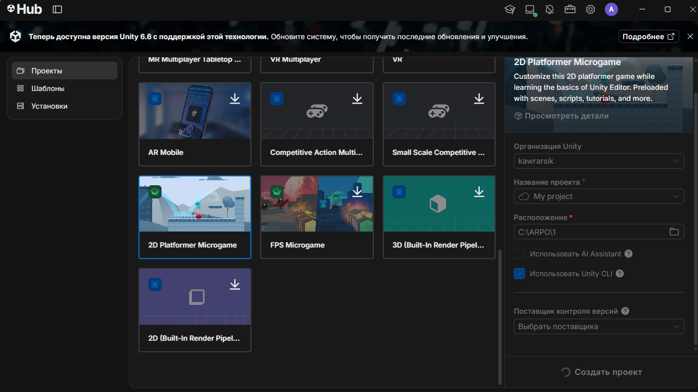
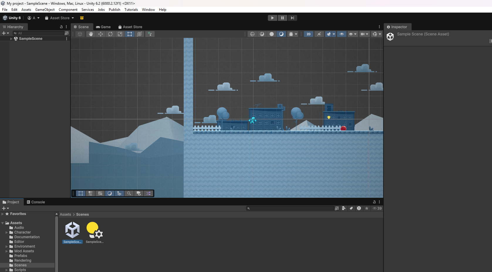
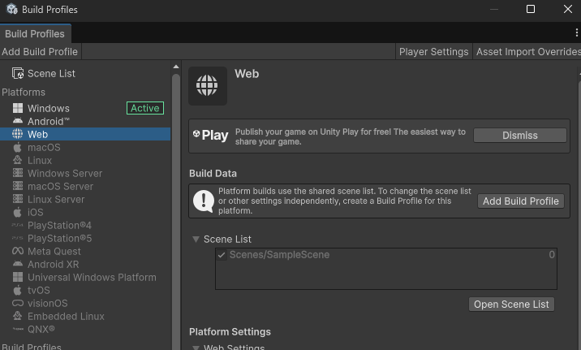
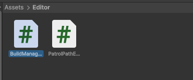
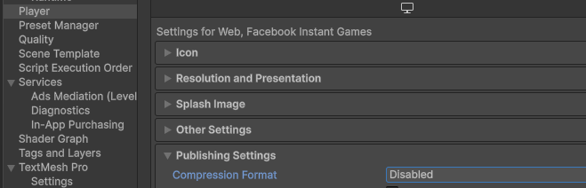
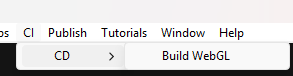
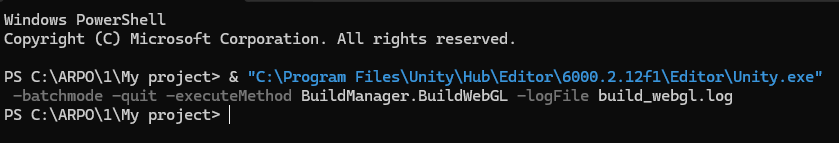
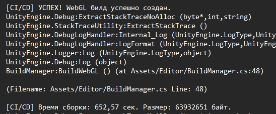
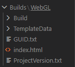
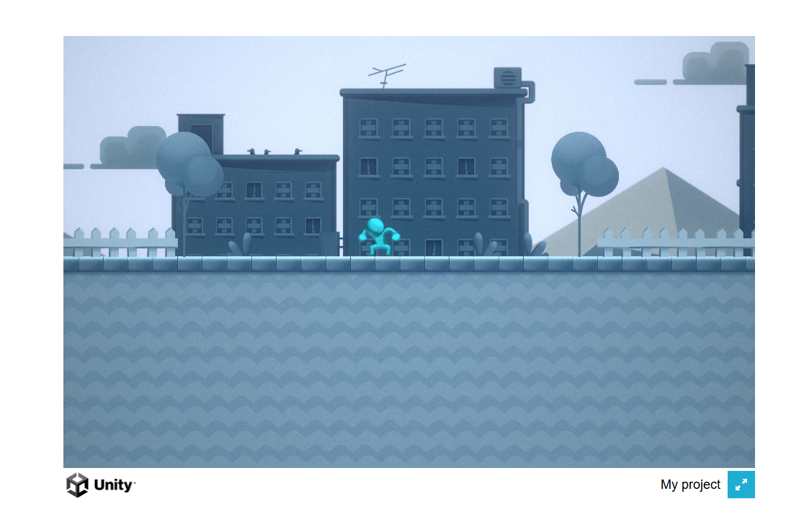

# Лабораторные работы по дисциплине «Автоматизация разработки программного обеспечения»

**Выполнил:** Хохлов А.А.  
**Группа:** 23CT  
**Проверил:** Бровко Н.В.  
**Учреждение:** Полоцкий государственный университет имени Евфросинии Полоцкой

---

## Лабораторная работа №1: Автоматизация сборки 2D-игры через командную строку (CLI)

**Цель работы:** Освоить автоматическую сборку проекта Unity под платформу WebGL средствами командной строки, без открытия графического интерфейса редактора, и зафиксировать результат в системе контроля версий Git.

### 1. Инициализация проекта и настройки сборки
Проект создан в Unity Hub на базе официального шаблона **2D Platformer Microgame**.


*Рисунок 1 — Создание проекта по шаблону 2D Platformer Microgame*

Игровая логика шаблона изучена. Основная сцена игры расположена в папке `Assets/Scenes` и добавлена в список сцен сборки (Build Settings), так как именно этот список читает скрипт сборки через API `EditorBuildSettings.scenes`.


*Рисунок 2 — Основная сцена игры в папке Assets/Scenes*


*Рисунок 3 — Список сцен сборки*

### 2. Разработка скрипта автоматической сборки
В проекте создана служебная папка `Assets/Editor`, код из которой выполняется только внутри редактора. Разработан скрипт `BuildManager.cs`, который собирает список активных сцен, настраивает параметры сборки и запускает компиляцию. Метод `BuildWebGL` объявлен как `public static`, поскольку Unity вызывает его по имени через рефлексию.


*Рисунок 4 — Скрипт BuildManager.cs в папке Assets/Editor*

### 3. Отключение сжатия WebGL
В настройках проигрывателя (`Project Settings -> Player -> WebGL -> Publishing Settings`) параметр **Compression Format** переключён со значения `Gzip` на `Disabled`. Это обязательный шаг для локального запуска.


*Рисунок 5 — Отключение сжатия WebGL*

### 4. Сборка проекта из командной строки
Проверка скрипта в редакторе показала, что он скомпилировался без ошибок, и в верхнем меню появился пользовательский пункт **CI**, созданный атрибутом `MenuItem`.


*Рисунок 6 — Пользовательский пункт меню CI → CD*

Консоль открыта в корневой папке проекта. Запущена команда автоматической сборки:

```powershell
& "C:\Program Files\Unity\Hub\Editor\6000.2.12f1\Editor\Unity.exe" -batchmode -quit -executeMethod BuildManager.BuildWebGL -logFile build_webgl.log
```


*Рисунок 7 — Запуск автоматической сборки из командной строки*

### 5. Результаты сборки и анализ лога
Сборка завершилась успешно, код возврата процесса равен нулю. В корне проекта создан файл `build_webgl.log`, в конце которого записаны сообщения скрипта сборки.


*Фрагмент лога с сообщением об успешной сборке*

Скомпилированные веб-файлы игры (`index.html`, `WebGL.wasm`, `WebGL.data` и др.) выгружены в папку `Builds/WebGL`.


*Рисунок 9 — Файлы сборки в папке Builds/WebGL*

### 6. Проверка работоспособности
Двойной клик по файлу `index.html` игру не запускает из-за политики CORS. Папка `Builds/WebGL` поднята локальным статическим веб-сервером (Live Server в VS Code). Игра открыта в браузере.


*Рисунок 10 — Игра, запущенная локально через веб-сервер*

### 7. Версионирование в Git
Создан файл `.gitignore`, исключающий служебные файлы. Базовое состояние проекта зафиксировано в ветке `main` (без скрипта). Работа выполнена в ветке `LR1`, создан Pull Request и слит с `main`.
