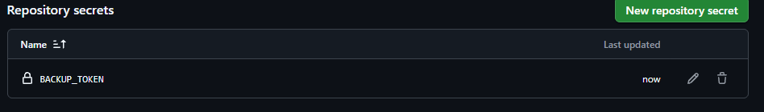
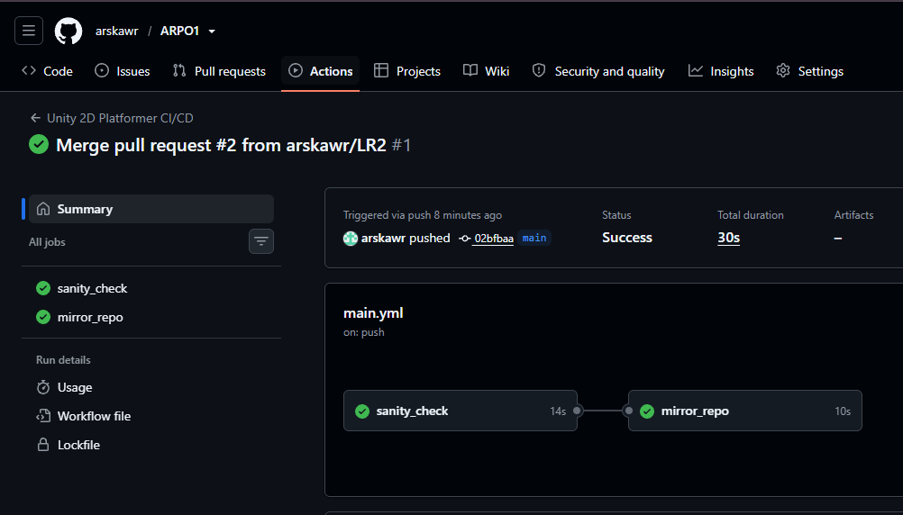
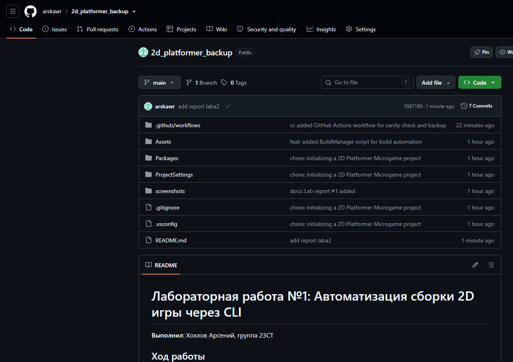

# Лабораторные работы по дисциплине «Автоматизация разработки программного обеспечения»

**Выполнил:** Хохлов А.А.  
**Группа:** 23CT  
**Проверил:** Бровко Н.В.  
**Учреждение:** Полоцкий государственный университет имени Евфросинии Полоцкой

---

## Лабораторная работа №2: Настройка CI/CD и зеркалирование репозитория

**Цель работы:** Изучить принципы построения декларативных сценариев CI на платформе GitHub Actions, освоить автоматическую проверку структуры проекта (Sanity Check) и настройку автоматического зеркалирования исходного кода.

### 1. Резервный репозиторий и секрет с токеном доступа
На GitHub создан второй, изначально пустой репозиторий `2d_platformer_backup`. В профиле GitHub создан персональный токен доступа (PAT). Токен сохранен в секретах основного репозитория под именем `BACKUP_TOKEN`.

*Скриншот 2.1 — Секрет BACKUP_TOKEN в настройках репозитория*

### 2. Разработка пайплайна GitHub Actions
В корне проекта создана служебная папка `.github/workflows` и в ней файл `main.yml`. Пайплайн состоит из двух задач:
1. **sanity_check**: выполняет быструю диагностику структуры проекта (проверяет наличие папок `ProjectSettings` и `Packages`, ищет C#-скрипты).
2. **mirror_repo**: объявлена с директивой `needs` и запускается только после успешной проверки. Она выгружает полную историю коммитов (`fetch-depth: 0`) и отправляет код в резервный репозиторий с помощью токена из секрета.

*Примечание: В шаблоне методички главной веткой названа `master`, однако в данном проекте главная ветка называется `main`. Поэтому триггер, имя владельца и приёмник зеркалирования были адаптированы под фактические значения.*

### 3. Отправка пайплайна и результаты
Работа велась в ветке `LR2`. Создан Pull Request, который был объединён с веткой `main`. Объединение PR породило событие `push`, по которому GitHub Actions запустил рабочий процесс `Unity 2D Platformer CI/CD`.

*Скриншот 2.2 — Успешное выполнение пайплайна (зеленые галочки)*

Резервный репозиторий перестал быть пустым: GitHub Actions скопировал туда весь код игры, структуру папок и историю коммитов.

*Скриншот 2.3 — Резервный репозиторий с заполненной историей коммитов*

### Общий вывод
В ходе выполнения лабораторных работ был настроен декларативный пайплайн непрерывной интеграции на GitHub Actions из двух задач. Освоена автоматическая сборка проекта Unity под платформу WebGL из командной строки, без открытия графического интерфейса редактора. Разработан скрипт `BuildManager.cs`, изучены флаги командной строки. Реализовано зеркалирование графа коммитов для отказоустойчивости. Все изменения проведены по принятому в разработке процессу: ветка → pull request → слияние с главной ветвью.