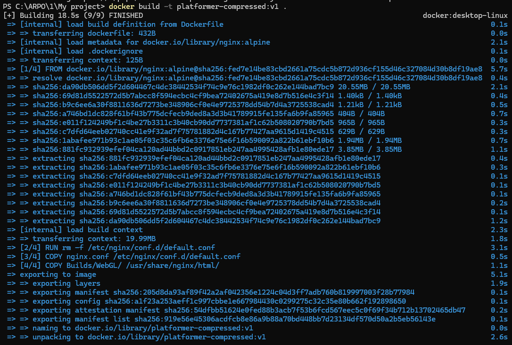
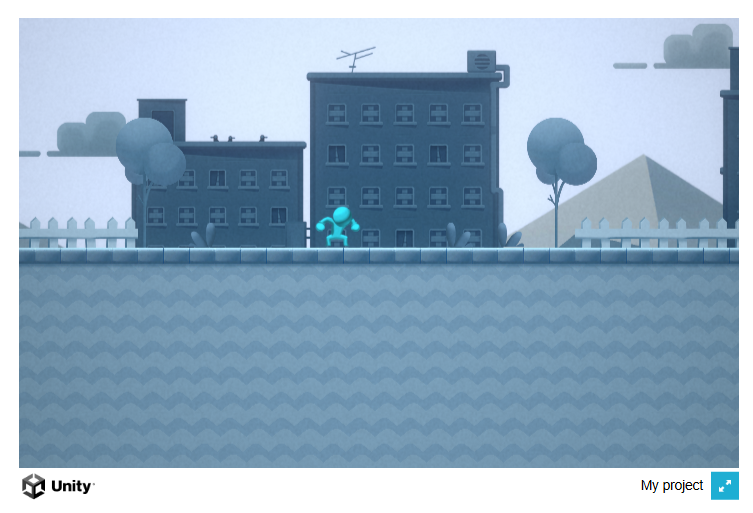
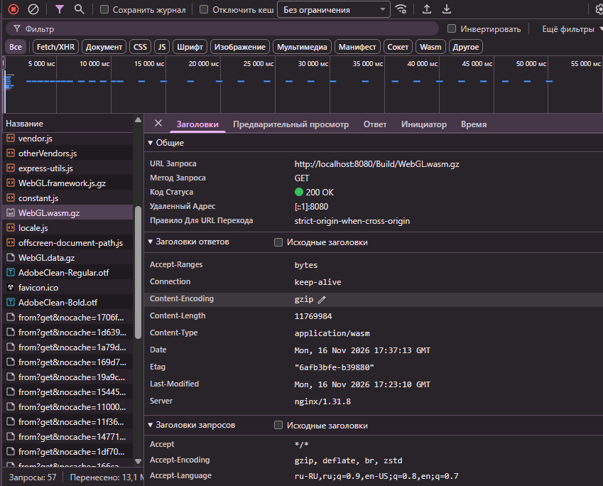
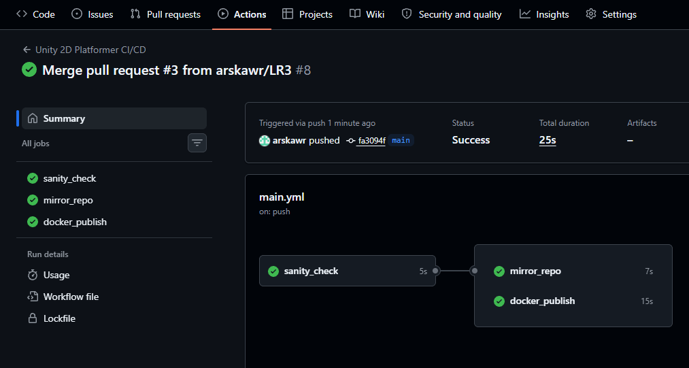
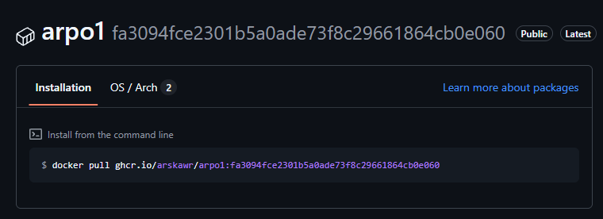

# Лабораторные работы по дисциплине «Автоматизация разработки программного обеспечения»

**Выполнил:** Хохлов А.А.  
**Группа:** 23CT  
**Проверил:** Бровко Н.В.  
**Учреждение:** Полоцкий государственный университет имени Евфросинии Полоцкой

---
# Лабораторная работа №3: Docker + Nginx (gzip) + GHCR

**Цель:** Изучение технологии контейнеризации (Docker) и настройки веб-сервера Nginx для раздачи сжатой WebGL-сборки Unity 6.

## Шаг 1. Настройка сжатия Gzip в Unity 6
В настройках проекта параметр Compression Format установлен в значение Gzip, а галочка Decompression Fallback снята. Проект пересобран.

## Шаг 2-3. Создание nginx.conf и Dockerfile
Создана кастомная конфигурация Nginx для подстановки заголовков Content-Encoding: gzip, а также Dockerfile на базе nginx:alpine для упаковки игры.

## Шаг 4. Локальное тестирование
Образ успешно собран, контейнер запущен на порту 8080.

Игра успешно открывается в браузере.

Проверены заголовки в DevTools (Network): Content-Encoding: gzip присутствует.

## Шаг 5-6. Пайплайн GitHub Actions
В пайплайн добавлена задача docker_publish. Образ успешно собран и опубликован в GHCR.

