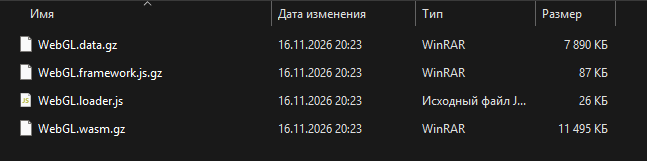
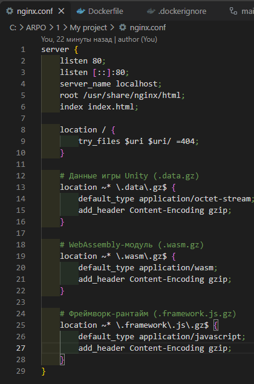
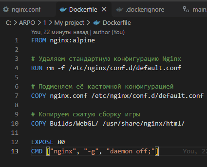

# Лабораторная работа №3: Контейнеризация веб-сервера в Docker и раздача сжатых файлов со стороны Nginx

**Цель работы:** Изучение технологии контейнеризации (Docker) и настройки веб-сервера Nginx для раздачи сжатой WebGL-сборки Unity 6 с корректным HTTP-заголовком `Content-Encoding: gzip`; упаковка веб-сервера с игрой в изолированный Docker-образ; автоматизация сборки и публикации образа в облачный реестр GitHub Container Registry (GHCR) средствами GitHub Actions.

## Исходные данные
*   **Основной репозиторий:** `https://github.com/arskawr/ARPO1` (проект 2D-платформера, ЛР №1–№2)
*   **Docker-образ в GHCR:** `https://github.com/arskawr/ARPO1/pkgs/container/arpo1`
*   **Окружение:** Unity 6000.2.12f1 (модуль WebGL), Docker Desktop (на базе WSL 2), веб-сервер Nginx (образ `nginx:alpine`).

---

## 1. Настройка сжатия Gzip в Unity 6 и локальная пересборка

В настройках проекта (`File -> Build Profiles -> Player Settings -> Player -> WebGL -> Publishing Settings`) параметр **Compression Format** был переключен обратно в значение `Gzip`, а галочка **Decompression Fallback** снята. Это необходимо для того, чтобы веб-сервер раздавал сжатие «по-честному», без использования медленного JavaScript-распаковщика на стороне клиента.

Значения зафиксированы в файле `ProjectSettings/ProjectSettings.asset`:
```yaml
webGLCompressionFormat: 1  # Gzip
webGLDecompressionFallback: 0 # без резервного JS-распаковщика
```

Проект пересобран из командной строки командой из ЛР №1 (редактор Unity был предварительно закрыт). В логе сборки появилось сообщение об успехе, а файлы в папке `Builds/WebGL/Build/` изменили свои расширения на `.gz` (например, `WebGL.wasm.gz`, `WebGL.data.gz`). Итоговый вес сборки сократился примерно в 3 раза.


*Скриншот 1 — Результат пересборки: сжатые Gzip-файлы Unity 6 в папке Builds/WebGL/Build/*

---

## 2. Создание конфигурации веб-сервера nginx.conf

В корне проекта был создан файл `nginx.conf`, который подменяет стандартную конфигурацию образа Nginx. Для сжатых файлов Unity принудительно подставляются заголовок `Content-Encoding: gzip` и корректные типы содержимого (MIME-типы).

```nginx
server {
    listen 80;
    listen [::]:80;
    server_name localhost;
    root /usr/share/nginx/html;
    index index.html;

    location / {
        try_files $uri $uri/ =404;
    }

    # Данные игры Unity (.data.gz)
    location ~* \.data\.gz$ {
        default_type application/octet-stream;
        add_header Content-Encoding gzip;
    }

    # WebAssembly-модуль (.wasm.gz)
    location ~* \.wasm\.gz$ {
        default_type application/wasm;
        add_header Content-Encoding gzip;
    }

    # Фреймворк-рантайм (.framework.js.gz)
    location ~* \.framework\.js\.gz$ {
        default_type application/javascript;
        add_header Content-Encoding gzip;
    }
}
```


*Скриншот 2 — Файл nginx.conf с правилами Content-Encoding: gzip*

---

## 3. Создание файла Dockerfile с подменой слоёв

Рядом был создан файл `Dockerfile`. За основу взят официальный образ `nginx:alpine`. В процессе сборки стандартная конфигурация Nginx удаляется и заменяется нашей, после чего поверх копируется сжатая WebGL-сборка игры. 

Дополнительно был добавлен файл `.dockerignore`, чтобы в контекст сборки не попадали служебные папки Unity (`Library/`, `Assets/`, `Temp/` и др.), так как они весят очень много и не нужны для работы готового контейнера.

```dockerfile
FROM nginx:alpine

# Удаляем стандартную конфигурацию Nginx из базового образа
RUN rm -f /etc/nginx/conf.d/default.conf

# Подменяем её кастомной конфигурацией с заголовками Content-Encoding: gzip
COPY nginx.conf /etc/nginx/conf.d/default.conf

# Копируем сжатую WebGL-сборку игры в корневую директорию Nginx
COPY Builds/WebGL/ /usr/share/nginx/html/

EXPOSE 80
CMD ["nginx", "-g", "daemon off;"]
```


*Скриншот 3 — Файл Dockerfile с инструкциями сборки образа*

---

## 4. Локальное тестирование контейнера

Из корня проекта был собран Docker-образ и запущен контейнер в фоновом режиме с пробросом порта 8080 на порт 80:

```powershell
docker build -t platformer-compressed:v1 .
docker run -d -p 8080:80 --name unity_compressed_container platformer-compressed:v1
```


*Скриншот 4 — Сборка образа platformer-compressed:v1: все шаги Dockerfile выполнены*

Игра успешно загрузилась в браузере на `http://localhost:8080`. Сжатые файлы распаковываются браузером нативно, без JS-фолбэка.


*Скриншот 5 — Игра из контейнера открыта в браузере на localhost:8080*

По контрольной точке из задания: в инструментах разработчика (`F12 -> Network`) после принудительной перезагрузки (`Ctrl+F5`) был выбран файл `WebGL.wasm.gz`. Во вкладке Headers видны заголовки ответа: `Content-Encoding: gzip`, `Content-Type: application/wasm`, `Server: nginx`. Именно наличие этого заголовка позволяет браузеру распаковать файл до передачи его в Unity-лоадер.


*Скриншот 6 — DevTools → Network → Headers файла WebGL.wasm.gz: Content-Encoding: gzip*

После проверки тестовый контейнер был остановлен и удалён:
```powershell
docker stop unity_compressed_container
docker rm unity_compressed_container
```
*(Команды выполняются по очереди, так как старый PowerShell не поддерживает оператор `&&`)*.

---

## 5. Модернизация облачного пайплайна в GitHub Actions

В файл `.github/workflows/main.yml` была добавлена третья задача `docker_publish` (запускается после `sanity_check` по директиве `needs`). Так как папка `Builds/` отсечена файлом `.gitignore` и отсутствует на серверах GitHub, в пайплайне настроено создание временных файлов-заглушек с расширением `.gz`. Это позволяет Docker-инструментам успешно завершить сборку образа (до подключения облачного Unity-компилятора в ЛР №4).

Образ публикуется в GitHub Container Registry (GHCR) под тегом ревизии коммита (`${{ github.sha }}`):
```yaml
  docker_publish:
    needs: sanity_check
    runs-on: ubuntu-latest
    permissions:
      contents: read
      packages: write
    steps:
      - uses: actions/checkout@v4
      - name: Создание временных файлов-заглушек .gz для сборки образа
        run: |
          mkdir -p Builds/WebGL/Build Builds/WebGL/TemplateData
          touch Builds/WebGL/index.html
          touch Builds/WebGL/Build/WebGL.loader.js
          touch Builds/WebGL/Build/WebGL.framework.js.gz
          touch Builds/WebGL/Build/WebGL.wasm.gz
          touch Builds/WebGL/Build/WebGL.data.gz
      - name: Вход в GitHub Container Registry (GHCR)
        uses: docker/login-action@v3
        with:
          registry: ghcr.io
          username: ${{ github.actor }}
          password: ${{ secrets.GITHUB_TOKEN }}
      - name: Сборка и публикация образа в GHCR
        uses: docker/build-push-action@v5
        with:
          context: .
          push: true
          tags: ghcr.io/arskawr/arpo1:${{ github.sha }}
```

---

## 6. Отправка изменений и результаты

Созданные файлы (`nginx.conf`, `Dockerfile`, `.dockerignore`), обновленный пайплайн и отчётные материалы зафиксированы в ветке `LR3` и отправлены на GitHub. Был создан Pull Request №3 для слияния с веткой `main`, который успешно смёржен. 

После слияния PR сработал триггер `push`, и пайплайн выполнил все три задачи (sanity_check, mirror_repo, docker_publish). Во вкладке **Actions** все задачи отмечены зелеными галочками.


*Скриншот 7 — Успешное выполнение всех трех задач пайплайна*

В профиле GitHub во вкладке **Packages** появился готовый пакет `arpo1`. Это и есть переносимый артефакт доставки (веб-сервер Nginx + сжатая игра внутри).


*Скриншот 8 — Опубликованный Docker-образ в GitHub Container Registry (GHCR)*

---

## Вывод
В ходе работы была освоена технология контейнеризации Docker. Был настроен веб-сервер Nginx для корректной раздачи сжатых Gzip-файлов Unity, что подтверждено наличием заголовка `Content-Encoding: gzip` в DevTools браузера. Игра и веб-сервер упакованы в изолированный Docker-образ. Автоматизирована сборка и публикация образа в облачный реестр GHCR с помощью GitHub Actions.