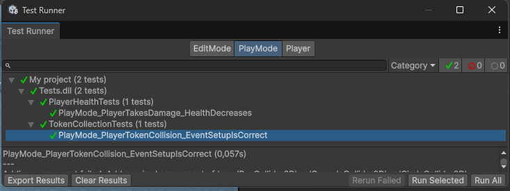
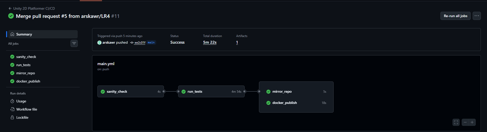
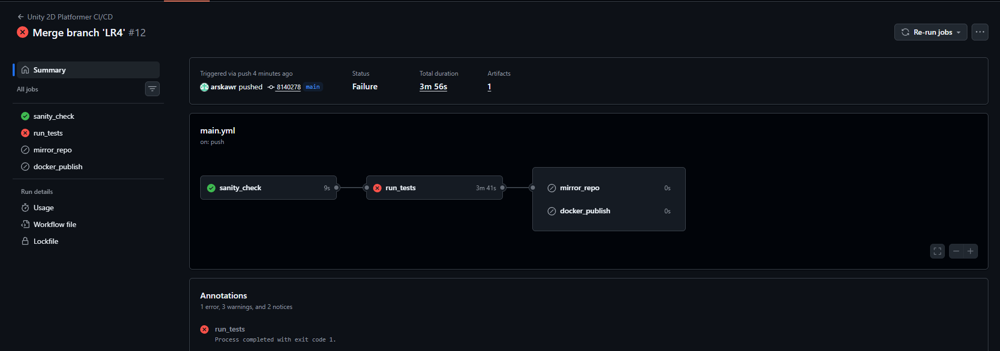

# Лабораторная работа №4: Автоматизация тестирования (Unity Test Runner) в CI/CD

**Вариант №17:** Механика `TokenInstance` + `PlayerTokenCollision` (PlayMode).
**Цель работы:** Настроить автоматический запуск Unity-тестов (EditMode и PlayMode) в облачном пайплайне так, чтобы компиляция игры и сборка Docker-образа выполнялись только при успешном прохождении всех тестов.

## 1. Разделение кодовой базы (Assembly Definitions)
Для изоляции тестового кода были созданы файлы Assembly Definition. Создан `GameAssembly` в папке `Assets/Scripts`, а также сборки `Tests` (EditMode) и `PlayModeTests` (PlayMode) в папке `Assets/Tests`. В инспекторе настроек тестовых сборок добавлена ссылка на `GameAssembly`. Также в `GameAssembly` добавлены ссылки на пакеты `InputSystem` и `Cinemachine`.

## 2. Написание автоматических тестов
Написаны два базовых теста (проверка тегов игрока и логика получения урона), а также индивидуальный PlayMode-тест по варианту №17. Тест `PlayMode_PlayerTokenCollision_EventSetupIsCorrect` проверяет, что при подборе токена корректно планируется событие `PlayerTokenCollision` с привязкой к игроку и токену.

 
*Скриншот 1 — Успешное прохождение всех трех тестов (EditMode и PlayMode) локально в Test Runner*

## 3. Облачный запуск тестов (GitHub Actions)
Пайплайн модернизирован: добавлена задача `run_tests`, использующая официальный CLI GameCI и контейнер `unityci/editor`. Добавлены секреты `UNITY_LICENSE`, `UNITY_EMAIL`, `UNITY_PASSWORD`. Задачи зеркалирования и сборки Docker-образа теперь используют директиву `needs: run_tests`. Результаты тестов сохраняются в артефактах (`test-results`).

*Скриншот 2 — Файл с результатами тестов*

## 4. Демонстрация защиты пайплайна (Test Gate)
Для проверки блокировки сборки в тест был намеренно внесен баг (изменено условие `Assert.IsNotNull` на `Assert.IsNull`). Пайплайн остановился на этапе `run_tests`, а задачи сборки Docker-образа и зеркалирования не запустились.

*Скриншот 3 - Пайплайн успешно выполнен*

*Скриншот 4 — Пайплайн остановлен из-за упавшего теста (задача run_tests красная, остальные пропущены)*

После возврата корректного кода пайплайн снова стал зеленым.

## Вывод
В ходе работы было настроено автоматическое тестирование Unity-проекта. Благодаря внедрению Test Runner в CI/CD пайплайн, сломанный код блокируется на этапе тестирования и не попадает в Docker-образ, что гарантирует стабильность сборок. Освоены EditMode и PlayMode тесты, а также работа с Assembly Definitions.