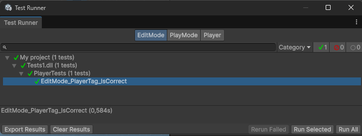
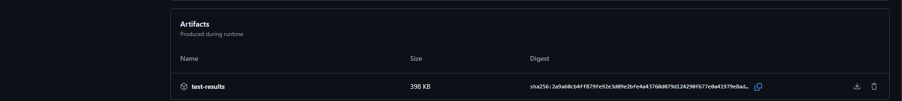

# Лабораторная работа №4: Автоматизация тестирования (Unity Test Runner) в CI/CD

**Вариант №17:** Механика `TokenInstance` + `PlayerTokenCollision` (PlayMode).
**Цель работы:** Настроить автоматический запуск Unity-тестов (EditMode и PlayMode) в облачном пайплайне так, чтобы компиляция игры и сборка Docker-образа выполнялись только при успешном прохождении всех тестов.

## 1. Разделение кодовой базы (Assembly Definitions)
Чтобы тестовые библиотеки не попадали в финальный билд игры, а тесты могли «видеть» код игры, были созданы файлы **Assembly Definition (.asmdef)**. 

*   В папке `Assets/Scripts` создан файл `GameAssembly.asmdef`, в который добавлены ссылки на пакеты `Unity.InputSystem` и `Unity.Cinemachine`.
*   В папке `Assets/Tests` созданы две папки (`EditMode` и `PlayMode`) с соответствующими файлами сборок. В настройках этих тестовых сборок добавлена ссылка на `GameAssembly`. 
*   Благодаря настройке `includePlatforms: [Editor]` в EditMode-сборке, Unity понимает, какие тесты запускать без симуляции игры, а какие — в режиме PlayMode.

## 2. Написание автоматических тестов
В проекте были написаны базовые тесты (проверка тегов и компонентов игрока, а также логика получения урона), и индивидуальный PlayMode-тест по варианту №17 (`TokenCollectionTests.cs`).

**Суть индивидуального теста:** Тест проверяет, что при подборе токена корректно планируется событие `PlayerTokenCollision`. Мы создаем объекты игрока и токена в «спящем» режиме, связываем их через событие и проверяем, что ссылки на игрока и токен успешно установлены. Это проверяет саму механику планирования события без запуска нестабильной физики и звуков в тестовой среде.

 
*Скриншот 1 — Успешное прохождение всех трех тестов (EditMode и PlayMode) локально в Test Runner*

## 3. Облачный запуск тестов (GitHub Actions)
Пайплайн модернизирован: добавлена задача `run_tests`, использующая официальный CLI GameCI и контейнер `unityci/editor`. Добавлены секреты `UNITY_LICENSE`, `UNITY_EMAIL`, `UNITY_PASSWORD`. Задачи зеркалирования и сборки Docker-образа теперь используют директиву `needs: run_tests`. Результаты тестов сохраняются в артефактах (`test-results`).

*Скриншот 2 — Файл с результатами тестов*

## 4. Демонстрация защиты пайплайна (Test Gate)
Для проверки блокировки сборки в тест был намеренно внесен баг (изменено условие `Assert.IsNotNull` на `Assert.IsNull`). Пайплайн остановился на этапе `run_tests`, а задачи сборки Docker-образа и зеркалирования не запустились.

*Скриншот 3 - Пайплайн успешно выполнен*

*Скриншот 4 — Пайплайн остановлен из-за упавшего теста (задача run_tests красная, остальные пропущены)*

После возврата корректного кода пайплайн снова стал зеленым.

## Вывод
В ходе работы было настроено автоматическое тестирование Unity-проекта с использованием Unity Test Framework. Благодаря внедрению тестов в CI/CD пайплайн (Test Stage), сломанный код автоматически блокируется и не попадает в финальный Docker-образ, что гарантирует стабильность сборок. Освоены EditMode и PlayMode тесты, а также настройка изолированных сборок (Assembly Definitions).