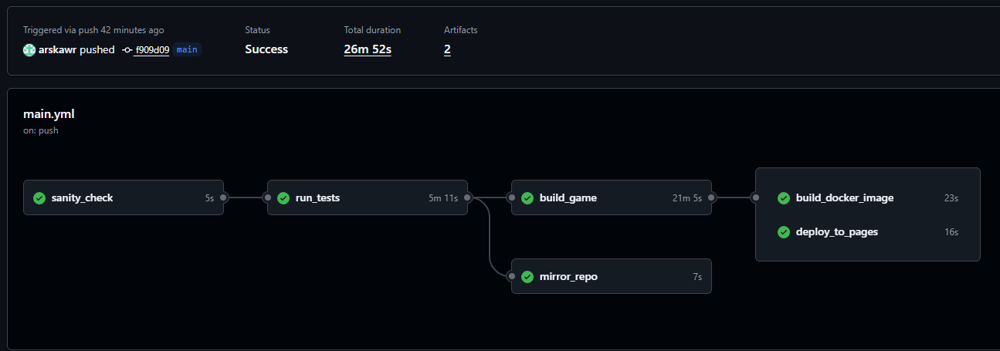
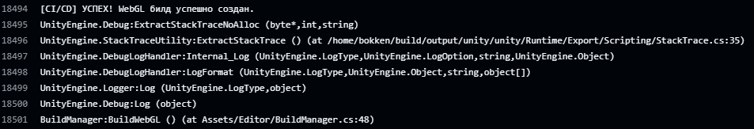
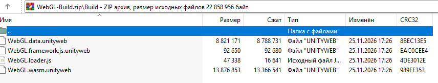
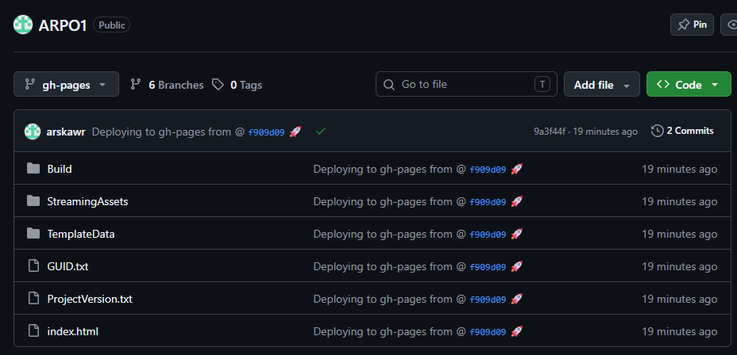
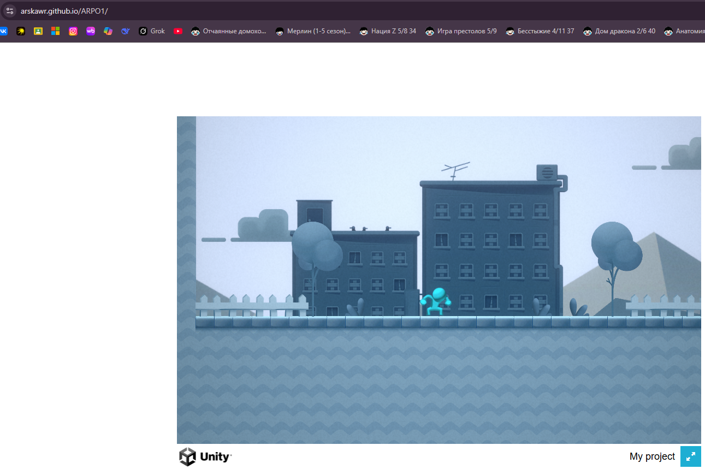
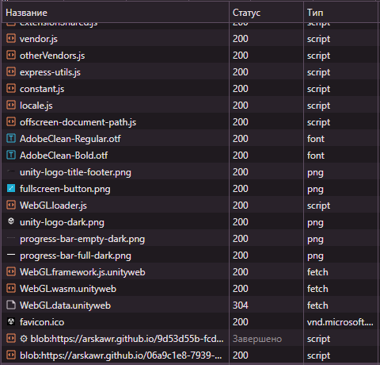
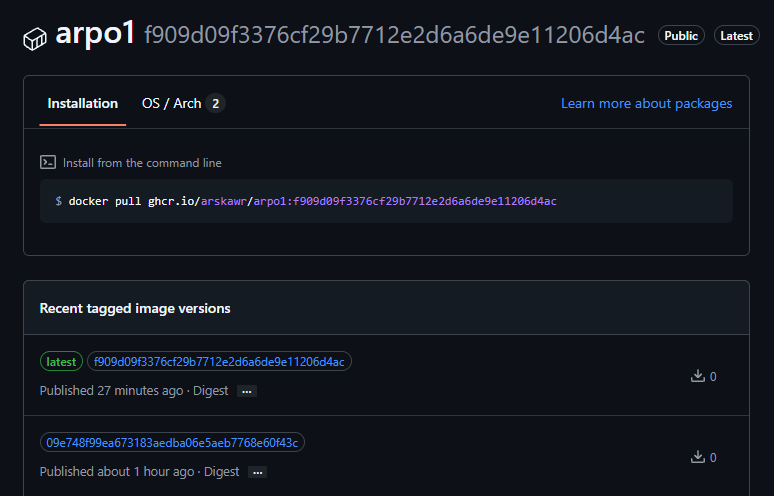
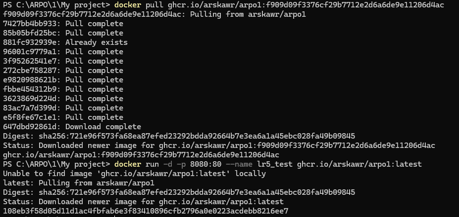
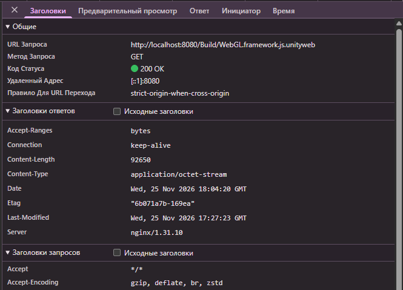

# Лабораторная работа №5: Автоматическая компиляция WebGL-игры в облаке и деплой на GitHub Pages

**Цель работы:** Настроить сквозной пайплайн, который после успешных тестов компилирует реальный WebGL-билд игры в облаке, публикует его на GitHub Pages и собирает Docker-образ с живой игрой вместо файлов-заглушек.

## 1. Подготовка Unity 6 к деплою на GitHub Pages
Так как GitHub Pages не поддерживает заголовки `Content-Encoding: gzip` (в отличие от нашего Nginx в ЛР3), в настройках Unity (`Publishing Settings`) был оставлен формат сжатия `Gzip`, но включена галочка **Decompression Fallback**. Из-за этого Unity внедрила JS-распаковщик в билд и изменила расширения файлов на `.unityweb`. Это позволяет игре работать на статическом хостинге.

## 2. Модернизация облачного пайплайна
В файл `.github/workflows/main.yml` были добавлены новые этапы:
*   **build_game:** Использует `game-ci/unity-builder` для реальной компиляции игры в контейнере. Вызывается метод `BuildManager.BuildWebGL` из ЛР №1. Скомпилированные файлы сохраняются в артефакт `WebGL-Build`.
*   **build_docker_image:** Теперь скачивает артефакт `WebGL-Build` и копирует *настоящие* файлы игры в Docker-образ (вместо заглушек `touch`).
*   **deploy_to_pages:** Скачивает артефакт и автоматически пушит его в служебную ветку `gh-pages` с помощью экшена `JamesIves/github-pages-deploy-action`.

---

## 3. Проверка результатов (по чек-листу из методички)

**1. Успешное выполнение всех задач пайплайна**
Вкладка Actions показывает, что задача `build_game` запустилась после успешных `run_tests`. Все пять задач отмечены зелеными галочками.

*Скриншот 1 — Успешное выполнение пайплайна со всеми пятью задачами*

**2. Лог реальной компиляции**
В логе задачи `build_game` присутствует строка `[CI/CD] УСПЕХ! WebGL билд успешно создан.` с указанием времени и размера, что подтверждает вызов метода `BuildWebGL` из ЛР №1.

*Скриншот 2 — Лог задачи build_game с подтверждением вызова скрипта*

**3. Артефакт с настоящими файлами**
Скачан артефакт `WebGL-Build`. Внутри лежат настоящие файлы (`index.html`, `Build/*.unityweb`), имеющие реальный вес (мегабайты), а не пустые заглушки.

*Скриншот 3 — Содержимое артефакта WebGL-Build с реальными файлами*

**4. Ветка gh-pages**
В служебную ветку `gh-pages` успешно выгружены `index.html` и папки `Build`, `StreamingAssets`, `TemplateData`.

*Скриншот 4 — Структура файлов в ветке gh-pages*

**5. Работающая игра на GitHub Pages**
После включения GitHub Pages в настройках репозитория (Settings -> Pages -> Branch: gh-pages), игра корректно загружается по публичной ссылке.

*Скриншот 5 — Игра, запущенная на GitHub Pages*

**6. Проверка загрузки и Decompression Fallback**
В инструментах разработчика (F12 -> Network) видно, что файлы `WebGL.wasm.unityweb`, `WebGL.data.unityweb` и др. загружаются с кодом 200 (или 304), а в консоли (Console) отсутствуют ошибки распаковки, что подтверждает работу `Decompression Fallback`.

*Скриншот 6 — Загрузка файлов .unityweb на GitHub Pages без ошибок*

**7. Docker-образ с живой игрой (GHCR)**
В профиле GitHub (вкладка Packages) появился пакет `arpo1` с тегами `latest` и хэшем последнего коммита.

*Скриншот 7 — Docker-образ в GHCR с тегами latest и github.sha*

При локальном запуске образа командой `docker run -d -p 8080:80 ghcr.io/arskawr/arpo1:latest` игра также работает корректно, так как внутри контейнера лежат настоящие файлы игры, а не заглушки.

*Скриншот 8 — Проверка локального контейнера с настоящей игрой*

---

## Вывод
В ходе работы был настроен полный сквозной CI/CD пайплайн. Теперь любой `git push` в ветку `main` автоматически запускает тесты, компилирует реальный WebGL-билд, деплоит его на бесплатный хостинг GitHub Pages и публикует готовый Docker-образ в реестр GHCR. Это полностью исключает человеческий фактор и ручную сборку.