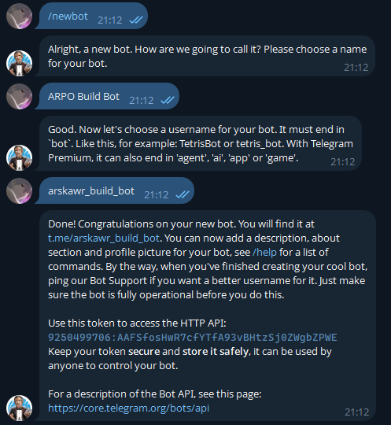
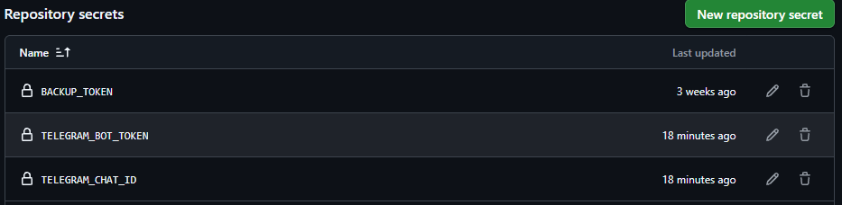
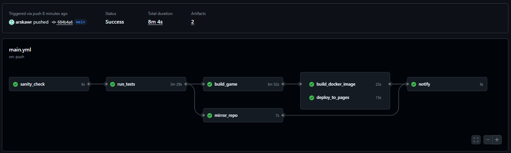
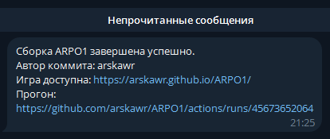
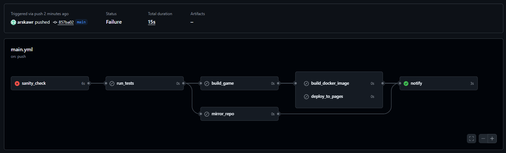
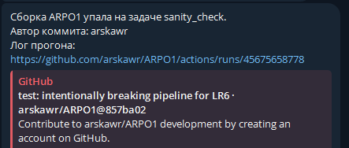

# Лабораторная работа №6: Мониторинг пайплайна, Webhooks и Telegram-оповещения

**Цель работы:** Настроить обратную связь от облачного сервера (GitHub Actions) к команде разработки при помощи Telegram-бота, который отправляет уведомления о результате пайплайна.

## 1. Создание Telegram-бота и получение параметров доступа
В Telegram через бота `@BotFather` создан новый бот. Получен токен доступа (`TELEGRAM_BOT_TOKEN`) и идентификатор чата (`TELEGRAM_CHAT_ID`) через метод `getUpdates` API Telegram. 

*Скриншот 1 — Создание бота через BotFather*

## 2. Добавление секретов в репозиторий
Для безопасного хранения учетных данных в настройках репозитория GitHub (Settings -> Secrets and variables -> Actions) созданы два секрета:
* `TELEGRAM_BOT_TOKEN`
* `TELEGRAM_CHAT_ID`

Значения токенов не попадают в исходный код и маскируются звездочками в логах сборки.

*Скриншот 2 — Секреты TELEGRAM_BOT_TOKEN и TELEGRAM_CHAT_ID в настройках репозитория*

## 3. Добавление задачи уведомления в пайплайн
В файл `.github/workflows/main.yml` добавлена задача `notify`. Она использует директиву `needs` для всех предыдущих задач и условие `if: always()`, что гарантирует её запуск при любом исходе пайплайна. Задача анализирует статусы предыдущих этапов и отправляет POST-запрос в Telegram через утилиту `curl`.

## 4. Проверка успешного сценария
После отправки изменений в репозиторий пайплайн успешно отработал. Все задачи зеленые. В Telegram пришло сообщение об успешной сборке с именем автора коммита и ссылкой на игру.

*Скриншот 3 — Успешное выполнение пайплайна*

*Скриншот 4 — Уведомление в Telegram об успешной сборке*

## 5. Проверка аварийного сценария
Для проверки работы уведомлений при ошибках в задачу `sanity_check` было внесено намеренное изменение (поиск несуществующей папки). Пайплайн упал на первом же этапе. Задача `notify` при этом выполнилась (осталась зеленой) и отправила сообщение об ошибке.

*Скриншот 5 — Пайплайн остановлен на задаче sanity_check*

*Скриншот 6 — Уведомление в Telegram о падении сборки*

После проверки код был возвращен в рабочее состояние.

## Вывод
В ходе работы был настроен механизм мониторинга CI/CD пайплайна. Теперь команда разработки мгновенно получает уведомления в Telegram о статусе сборки, что позволяет оперативно реагировать на ошибки и не пропускать успешные релизы. Освоены принципы работы Webhooks, Telegram Bot API и безопасного хранения секретов.