# Лабораторные работы по дисциплине «Автоматизация разработки программного обеспечения»

**Выполнил:** Хохлов А.А.  
**Группа:** 23СТ  
**Проверил:** Бровко Н.В.  
**Учреждение:** Полоцкий государственный университет имени Евфросинии Полоцкой

---

## Лабораторная работа №1: Автоматизация сборки 2D-игры через командную строку (CLI)

**Цель работы:** Освоить автоматическую сборку проекта Unity под платформу WebGL средствами командной строки, без открытия графического интерфейса редактора, и зафиксировать результат в системе контроля версий Git.

### 1. Инициализация проекта и настройки сборки
Проект создан в Unity Hub на базе официального шаблона **2D Platformer Microgame**.
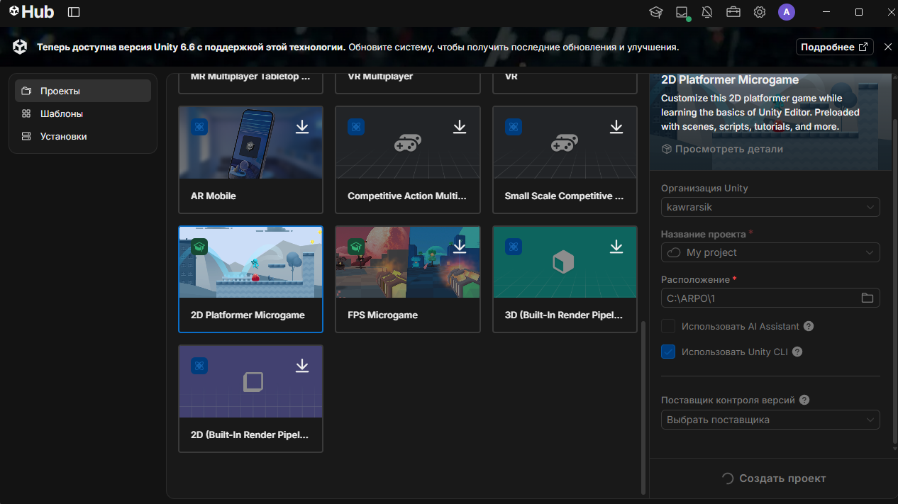

Игровая логика шаблона изучена. Основная сцена игры расположена в папке `Assets/Scenes` и добавлена в список сцен сборки (Build Settings), так как именно этот список читает скрипт сборки через API `EditorBuildSettings.scenes`.
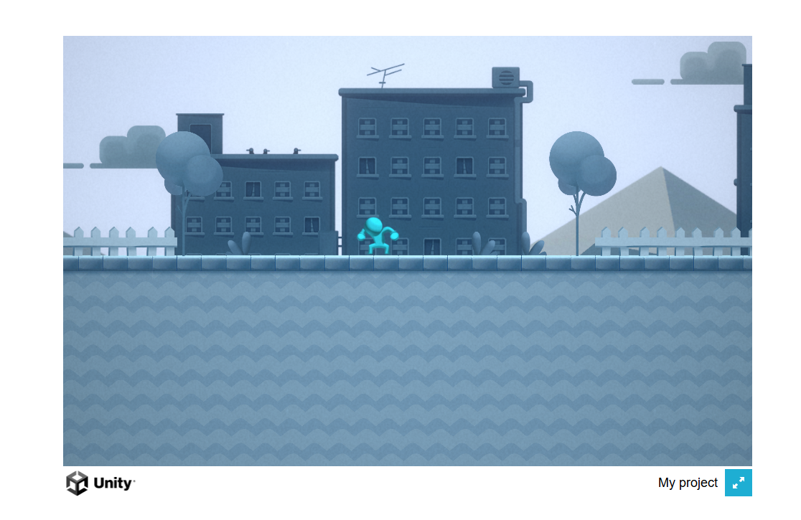
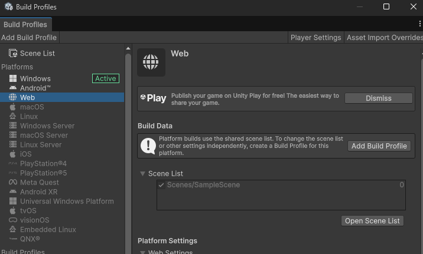

### 2. Разработка скрипта автоматической сборки
В проекте создана служебная папка `Assets/Editor`, код из которой выполняется только внутри редактора. Разработан скрипт `BuildManager.cs`, который собирает список активных сцен, настраивает параметры сборки и запускает компиляцию.

Метод `BuildWebGL` объявлен как `public static`, поскольку Unity вызывает его по имени через рефлексию, не создавая экземпляр класса. Атрибут `[MenuItem]` позволяет запускать тот же метод из меню редактора.
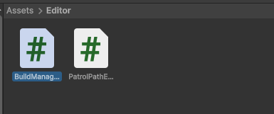

### 3. Отключение сжатия WebGL
В настройках проигрывателя (`Project Settings -> Player -> WebGL -> Publishing Settings`) параметр **Compression Format** переключён со значения `Gzip` на `Disabled`. Это обязательный шаг для локального запуска: браузер не распаковывает сжатую сборку, открытую через локальный веб-сервер, и игра зависает на полосе загрузки.
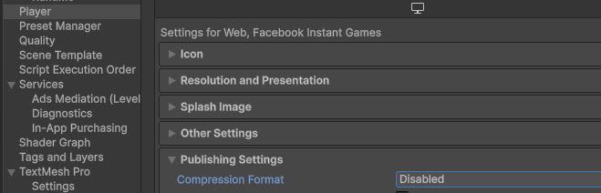

После сохранения настроек редактор был закрыт: консольная сборка открывает проект монопольно.

### 4. Сборка проекта из командной строки
Проверка скрипта в редакторе показала, что он скомпилировался без ошибок, и в верхнем меню появился пользовательский пункт **CI**, созданный атрибутом `MenuItem`.
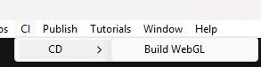

Консоль открыта в корневой папке проекта. Запущена команда автоматической сборки:
```powershell
& "C:\Program Files\Unity\Hub\Editor\6000.2.12f1\Editor\Unity.exe" -batchmode -quit -executeMethod BuildManager.BuildWebGL -logFile build_webgl.log
```
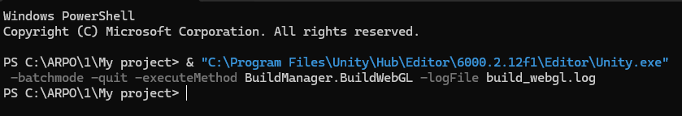

### 5. Результаты сборки и анализ лога
Сборка завершилась успешно, код возврата процесса равен нулю. В корне проекта создан файл `build_webgl.log`, в конце которого записаны сообщения скрипта сборки.
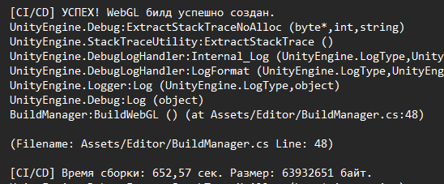

Скомпилированные веб-файлы игры (`index.html`, `WebGL.wasm`, `WebGL.data` и др.) выгружены в папку `Builds/WebGL`.
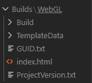

### 6. Проверка работоспособности
Двойной клик по файлу `index.html` игру не запускает из-за политики CORS. Папка `Builds/WebGL` поднята локальным статическим веб-сервером (Live Server в VS Code). Игра открыта в браузере, полоса загрузки доходит до конца, персонаж реагирует на управление.


### 7. Версионирование в Git
Создан файл `.gitignore`, исключающий служебные файлы (`Library/`, `Temp/`, `Builds/` и др.). Базовое состояние проекта зафиксировано в ветке `main` (без скрипта). Работа выполнена в ветке `LR1`, создан Pull Request и слит с `main`.

---

## Лабораторная работа №2: Настройка CI/CD и зеркалирование репозитория

**Цель работы:** Изучить принципы построения декларативных сценариев CI на платформе GitHub Actions, освоить автоматическую проверку структуры проекта (Sanity Check) и настройку автоматического зеркалирования исходного кода.

### 1. Резервный репозиторий и секрет с токеном доступа
На GitHub создан второй, изначально пустой репозиторий `2d_platformer_backup`. В профиле GitHub создан персональный токен доступа (PAT) с областями доступа `repo` и `workflow`. Токен сохранен в секретах основного репозитория под именем `BACKUP_TOKEN`. В исходном коде значение токена не приводится: в YAML-файле на него ссылается только выражение `${{ secrets.BACKUP_TOKEN }}`.
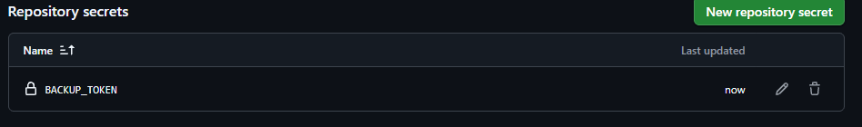

### 2. Разработка пайплайна GitHub Actions
В корне проекта создана служебная папка `.github/workflows` и в ней файл `main.yml`. Пайплайн состоит из двух задач:
1. **sanity_check**: выполняет быструю диагностику структуры проекта (проверяет наличие папок `ProjectSettings` и `Packages`, ищет C#-скрипты).
2. **mirror_repo**: объявлена с директивой `needs` и запускается только после успешной проверки. Она выгружает полную историю коммитов (`fetch-depth: 0`) и отправляет код в резервный репозиторий с помощью токена из секрета.

*Примечание: В шаблоне методички главной веткой названа `master`, однако в данном проекте главная ветка называется `main`. Поэтому триггер, имя владельца и приёмник зеркалирования были адаптированы под фактические значения.*

### 3. Отправка пайплайна и результаты
Работа велась в ветке `LR2`. Создан Pull Request, который был объединён с веткой `main`. Объединение PR породило событие `push`, по которому GitHub Actions запустил рабочий процесс `Unity 2D Platformer CI/CD`. Задача зеркалирования стартовала только после успешного завершения проверки.
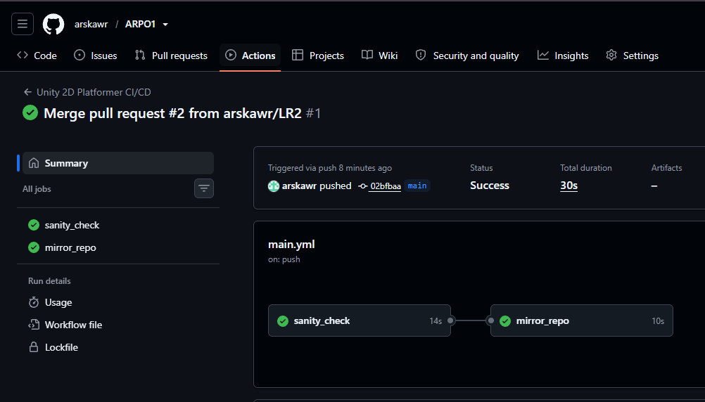

Резервный репозиторий перестал быть пустым: GitHub Actions скопировал туда весь код игры, структуру папок и историю коммитов.
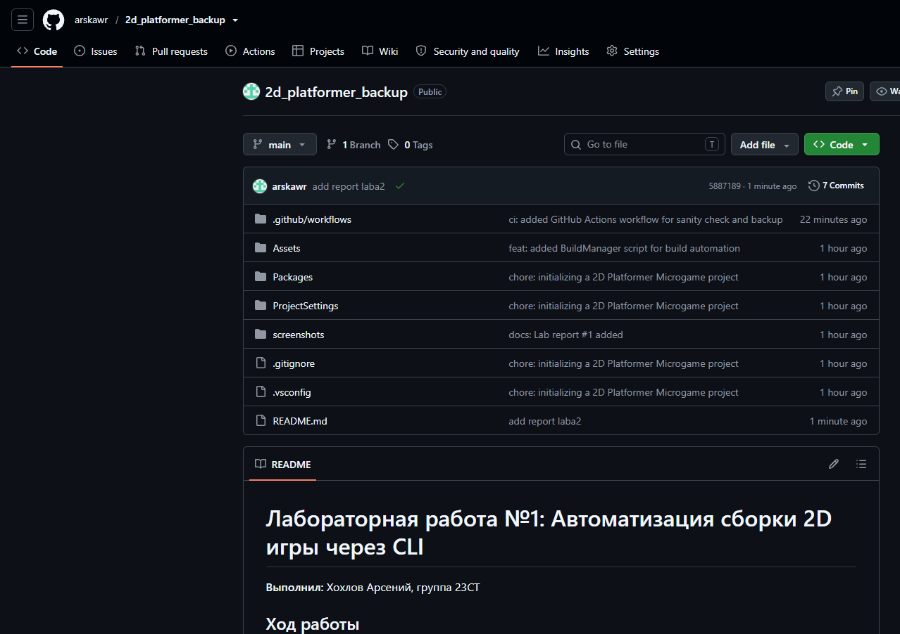

### Общий вывод
В ходе выполнения лабораторных работ был настроен декларативный пайплайн непрерывной интеграции на GitHub Actions из двух задач. Освоена автоматическая сборка проекта Unity под платформу WebGL из командной строки, без открытия графического интерфейса редактора. Разработан скрипт `BuildManager.cs`, изучены флаги командной строки (`-batchmode`, `-nographics`, `-executeMethod`, `-quit`). Реализовано зеркалирование графа коммитов для отказоустойчивости с использованием персонального токена доступа. Все изменения проведены по принятому в разработке процессу: ветка → pull request → слияние с главной ветвью.