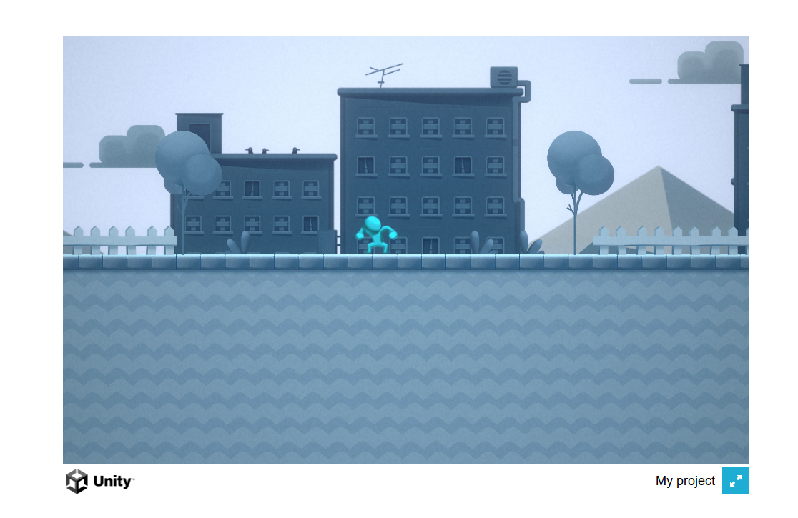

# Лабораторная работа №1: Автоматизация сборки 2D игры через CLI

**Выполнил:** Хохлов Арсений, группа 23СТ

## Ход работы

### 1. Создание скрипта сборщика
Был создан скрипт `Assets/Editor/BuildManager.cs` для автоматической сборки проекта под WebGL.

### 2. Сборка через CLI
Сборка выполнена командой:
`Unity.exe -batchmode -quit -executeMethod BuildManager.BuildWebGL -logFile build_webgl.log`

Лог успешной сборки:

### 3. Проверка игры
Игра успешно запущена локально через Live Server.

---

## Лабораторная работа №2: Настройка CI/CD и зеркалирование

В ходе работы был настроен пайплайн GitHub Actions (.github/workflows/main.yml).

**Что делает пайплайн:**
1. **Sanity Check:** Проверяет наличие папок `ProjectSettings` и `Packages`, а также ищет скрипты `*Controller.cs` и `BuildManager.cs`.
2. **Mirroring:** Автоматически отправляет (зеркалирует) весь код в резервный репозиторий с помощью секретного токена (PAT).

**Результаты:**
Пайплайн успешно отработал. Обе задачи (sanity_check и mirror_repo) выполнены с зелеными галочками.
Резервный репозиторий успешно заполнен исходным кодом.

## Вывод
В ходе работы был автоматизирован процесс сборки Unity-проектов с помощью командной строки, что необходимо для CI/CD пайплайнов.